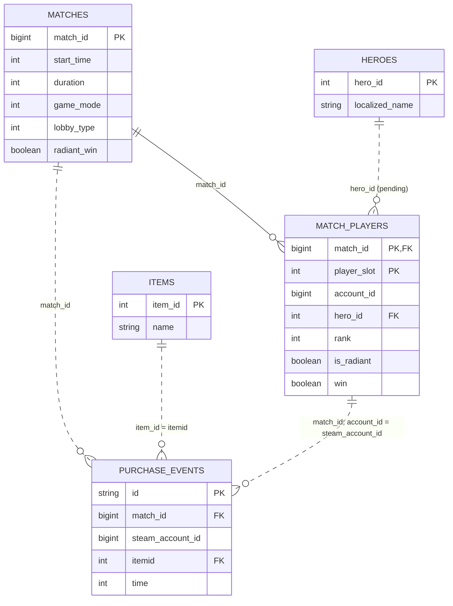

# Модель данных кейса 1

**Результат:** одна строка на первую покупку Доминатора игроком в матче. Ключ — `(match_id, steam_account_id)`.

Схемы и результаты проверок предоставлены пользователем. Подтверждены ключи предметов, матчей, участников по слоту и ID покупок Доминатора. Найдены отсутствующие связи и неизвестные ранги. SQL-процессы читают текущий RAW; числа ниже относятся к профилированию прежних снимков. Цель и решения — в [паспорте кейса](case_definition.md).

## Таблицы и связи

Основные таблицы находятся в `lakehouse.raw`.

| Таблица | Назначение и ключ |
|---|---|
| `pg__items` | 244 предмета; `item_id` уникален и ненулевой; Доминатор — `164` |
| `mongo__purchase_events` | 17 863 события Доминатора; `id` типа `string` уникален, пропусков и конфликтов не найдено |
| `pg__matches` | По результату запроса пользователя: 317 104 строки и столько же уникальных `match_id`, NULL и повторов нет — одна строка на матч в проверенном наборе |
| `pg__match_players` | 4 679 251 участник; `(match_id, player_slot)` уникален и ненулевой |
| `pg__heroes` | Названия героев по `hero_id`; доступность RAW-таблицы ещё не подтверждена |

| Связь | Условие |
|---|---|
| Покупка → предмет | `purchase.itemid = items.item_id` |
| Покупка → матч | `purchase.match_id = matches.match_id` |
| Покупка → участник | `purchase.match_id = mp.match_id AND purchase.steam_account_id = mp.account_id` |
| Участник → герой | `mp.hero_id = heroes.hero_id`, если справочник доступен |

Пара `(match_id, account_id)` используется для сопоставления покупок, но не является документированным первичным ключом участников. Для каждой покупки нужен ровно один матч и один участник. Отсутствующие и неоднозначные связи выявляем через LEFT JOIN и проверку числа соответствий; произвольный выбор строки недопустим.

В RAW участников найдено 246 551 повторяющаяся пара `(match_id, account_id)`; среди примеров есть аккаунты `0` и `4294967295`. По пояснению пользователя, `0` — бот, `4294967295` — анонимный игрок. Для покупателей Доминатора неоднозначных связей не найдено, но у 3 449 из 17 781 пары нет матча или участника. Однозначно связаны 14 332 пары; исходы согласованы, размножения строк нет.

Ботов (`account_id = 0` или `steam_account_id = 0`) исключаем из аналитического набора, сохраняя RAW и остальных участников матча. Анонимных игроков автоматически не исключаем: если покупка однозначно сопоставлена участнику и известна его сторона, исход команды можно определить.

Общий ID `4294967295` не различает нескольких анонимных игроков. Если такой ID указан и в покупках разных участников, нельзя объединять их покупки через `min(time)` на `(match_id, steam_account_id)`: потребуется проверенная привязка к `player_slot` или другому уникальному ключу. В подтверждённой схеме покупок слота и стороны нет. Победитель матча сам по себе не устанавливает сторону покупателя; неразрешённые связи остаются в диагностике.

Отдельная проверка текущего RAW нашла 3 397 пар с существующим матчем и отсутствующим участником: у 14 нет строк участников матча, у остальных 3 383 в матче есть анонимы. Это не доказывает, кто именно купил предмет. Такие пары остаются с `player_not_found`; связь по одному `match_id` не восстанавливаем. Других однозначно определённых покупателей тех же матчей сохраняем. Эти числа получены на текущем RAW до фильтров режима/лобби и не заменяют отчёт прежнего среза.

Ключи `match_id`, `account_id` и `steam_account_id` имеют тип `bigint`; `item_id`, `itemid`, `player_slot`, `hero_id` и `rank` — `int`. Поля `win`, `is_radiant` и `radiant_win` — `boolean`. Типы ключей совместимы для соединений.

По комментариям RAW: `time` — секунды от начала матча, `duration` — секунды, `start_time` — Unix timestamp типа `int`. Среди 17 863 покупок Доминатора нет NULL и отрицательного времени; среди 14 390 однозначно связанных событий нет выхода за длительность матча. Полнота истории ещё не подтверждена.

Во всех четырёх таблицах есть `job_id` (`string`), `sys_insert_stamp` и `src_modified_stamp` (`timestamp`). Это ID загрузки, время записи в озеро и метка изменения источника. Они помогут исследовать загрузки, но правило выбора версии строки ещё не определено.

В ER-диаграмме показаны ожидаемые логические ключи и связи, а не проверенная уникальность RAW. Поля справочника героев пока известны только из документации. Отсутствие имени героя не должно удалять наблюдение с известным `hero_id`.

## ER-диаграмма

## Поля итогового набора

Логическое имя — `dominator_first_purchase`. Подготовлены SQL событий и первых покупок; процессы на сайте ещё не созданы агентом.

| Поле | Источник или правило |
|---|---|
| `match_id`, `steam_account_id` | Ключи из покупок |
| `first_purchase_time` | `min(time)` для `itemid = 164` на пару «матч–покупатель» после проверки всей истории пары |
| `hero_id`, `rank`, `is_radiant`, `win` | Участник матча |
| `duration`, `game_mode`, `lobby_type`, `radiant_win` | Матч |

Единица и точка отсчёта времени описаны в комментариях RAW; корректность фактических значений ещё нужно проверить. `min(time)` игнорирует NULL: удаление проблемного события не должно превращать следующую покупку в достоверную первую.

После соединений проверяем уникальность ключа и объясняем изменения количества строк. Исход сверяем по правилу: `win = radiant_win` для Radiant, иначе `win = NOT radiant_win`; NULL и противоречия учитываем отдельно.

Повторные покупки не создают новых наблюдений. Покупатели одного матча остаются отдельными, зависимыми наблюдениями, в том числе на противоположных сторонах.

По решению пользователя допускаем не больше двух событий Доминатора на `(match_id, steam_account_id)`. При превышении сохраняем все события с `excessive_purchase_events`, но не включаем пару в первые покупки. Это эвристика подозрения на бота, а не доказанная классификация. При одном или двух событиях выбираем минимальное время; других покупателей матча не исключаем.

Дубли ID и совпадающие наборы основных полей покупок Доминатора не найдены. Отсутствующие/неоднозначные связи сохраняем в диагностике; в первые покупки они не попадают. По пояснению пользователя, NULL ранга означает игрока без ранга/на калибровке. Его сохраняем с признаком `rank_is_unknown`; это справочный признак, а не причина исключения или обязательная переменная основной гипотезы.

## Таблицы STAGE

Имена ниже указываются в форме создания SQL-процесса портала без префикса `lakehouse.stage`; перед созданием проверить, что они относятся к этому проекту.

| Таблица в `lakehouse.stage` | Содержимое |
|---|---|
| `case1_dominator_purchase_events` | [SQL событий](stage_purchase_events.sql). Все исходные строки `itemid = 164`, включая диагностические. Контекст добавлен без размножения; `dq_reasons` хранит причины исключения, `event_valid` — результат проверки. Если ID повторяется в RAW, строки сохраняются с ошибкой, а не схлопываются |
| `case1_dominator_first_purchase` | [SQL первых покупок](stage_first_purchase.sql). Одна строка на `(match_id, steam_account_id)` только для пар без проблемных событий; сохраняется `player_slot`. Первое время в секундах/минутах, Unix-время покупки, число событий и группа `early`/`late` |

Обе таблицы содержат `stage_loaded_at` и `rules_version` (актуальная версия — `case1-stage-sql-v2`). Первая сохраняет `source_job_id`, время исходной загрузки, `buyer_purchase_events_count` и `exceeds_purchase_limit`. Вторая содержит `source_stage_loaded_at` для сверки версии событий, `is_anonymous`, `rank_is_unknown`, `history_complete = NULL` и `is_provisional = true`. Техническая проверка не доказывает полноту истории. Время матча/покупки хранится также в Unix-секундах, без зависимости от часового пояса SQL-движка.

Требования: сохраняем весь доступный срез за 14–15 октября 2026 года до конца буткемпа и 30 дней после защиты; при изменении входов пересчитываем раз в час. Проектный срез исходных данных или его выгрузку также сохраняем для воспроизведения. Это требования, фактическое хранение и расписание пока не настроены.

Портал выполняет полную замену каждой проектной таблицы. Две записи не атомарны вместе: после обновления событий нужно дождаться пересборки первых покупок. [Проверочный SQL](stage_checks.sql) показывает объёмы, ошибки ключей, попадание проблемных пар и расхождение `source_stage_loaded_at`. Аудит входных снимков и SLA проверяются при реализации. До запуска SQL нужно явно ограничить даты матчей согласованным периодом; сейчас процессы остаются заготовками для критерия №3.
