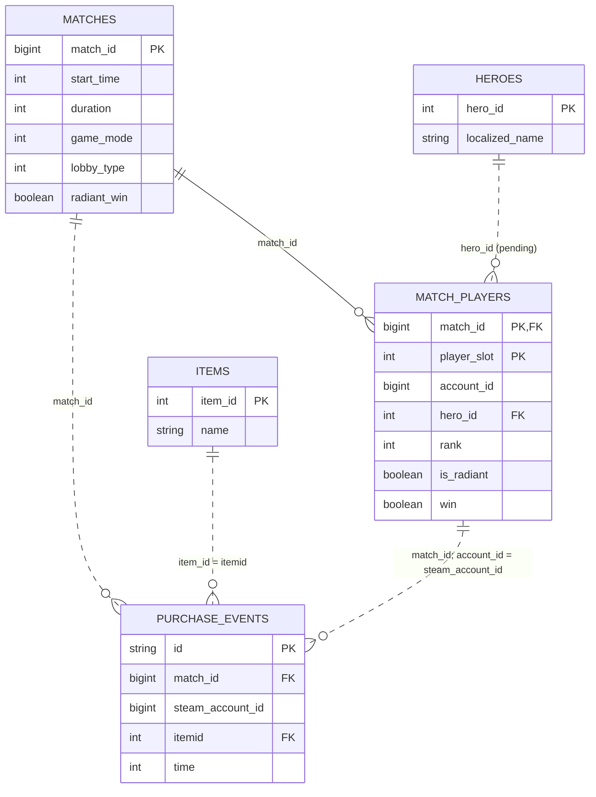

# Модель данных кейса 1

**Результат:** одна строка на первую покупку Доминатора игроком в матче. Ключ — `(match_id, steam_account_id)`.

Имена и типы полей четырёх основных RAW-таблиц подтверждены выводом `DESCRIBE TABLE`, предоставленным пользователем. Примеры значений просмотрены; уникальность, связи и качество всего набора ещё не проверены. Цель и план работы — в [паспорте кейса](case_definition.md).

## Таблицы и связи

Основные таблицы находятся в `lakehouse.raw`.

| Таблица | Назначение и ключ |
|---|---|
| `pg__items` | Справочник предметов, `item_id`; нужен Доминатор `164` |
| `mongo__purchase_events` | События покупок, ID — `id` типа `string`; уникальность проверить |
| `pg__matches` | Матчи, ожидается одна запись на `match_id` |
| `pg__match_players` | Участники; по документации ключ `(match_id, player_slot)`, оба поля есть в RAW; уникальность проверить |
| `pg__heroes` | Названия героев по `hero_id`; доступность RAW-таблицы ещё не подтверждена |

| Связь | Условие |
|---|---|
| Покупка → предмет | `purchase.itemid = items.item_id` |
| Покупка → матч | `purchase.match_id = matches.match_id` |
| Покупка → участник | `purchase.match_id = mp.match_id AND purchase.steam_account_id = mp.account_id` |
| Участник → герой | `mp.hero_id = heroes.hero_id`, если справочник доступен |

Пара `(match_id, account_id)` используется для сопоставления покупок, но не является документированным первичным ключом участников. Для каждой покупки нужен ровно один матч и один участник. Отсутствующие и неоднозначные связи выявляем через LEFT JOIN и проверку числа соответствий; произвольный выбор строки недопустим.

Ключи `match_id`, `account_id` и `steam_account_id` имеют тип `bigint`; `item_id`, `itemid`, `player_slot`, `hero_id` и `rank` — `int`. Поля `win`, `is_radiant` и `radiant_win` — `boolean`. Типы ключей совместимы для соединений.

По комментариям RAW: `time` — секунды от начала матча, `duration` — секунды, `start_time` — Unix timestamp типа `int`. Примеры соответствуют этим описаниям; проверка диапазонов и связей на всём наборе ещё предстоит.

Во всех четырёх таблицах есть `job_id` (`string`), `sys_insert_stamp` и `src_modified_stamp` (`timestamp`). Это ID загрузки, время записи в озеро и метка изменения источника. Они помогут исследовать загрузки, но правило выбора версии строки ещё не определено.

В ER-диаграмме показаны ожидаемые логические ключи и связи, а не проверенная уникальность RAW. Поля справочника героев пока известны только из документации. Отсутствие имени героя не должно удалять наблюдение с известным `hero_id`.

## ER-диаграмма

## Поля итогового набора

Логическое имя — `dominator_first_purchase`; физическая таблица пока не создана.

| Поле | Источник или правило |
|---|---|
| `match_id`, `steam_account_id` | Ключи из покупок |
| `first_purchase_time` | `min(time)` для `itemid = 164` на пару «матч–покупатель» после проверки всей истории пары |
| `hero_id`, `rank`, `is_radiant`, `win` | Участник матча |
| `duration`, `game_mode`, `lobby_type`, `radiant_win` | Матч |

Единица и точка отсчёта времени описаны в комментариях RAW; корректность фактических значений ещё нужно проверить. `min(time)` игнорирует NULL: удаление проблемного события не должно превращать следующую покупку в достоверную первую.

После соединений проверяем уникальность ключа и объясняем изменения количества строк. Исход сверяем по правилу: `win = radiant_win` для Radiant, иначе `win = NOT radiant_win`; NULL и противоречия учитываем отдельно.

Повторные покупки не создают новых наблюдений. Покупатели одного матча остаются отдельными, зависимыми наблюдениями, в том числе на противоположных сторонах.

Правила обработки дублей ещё нужно определить после проверки `id` и содержимого событий. Одинаковое время покупки само по себе не доказывает дубль. ETL и физические таблицы спроектируем отдельно после проверки данных.
