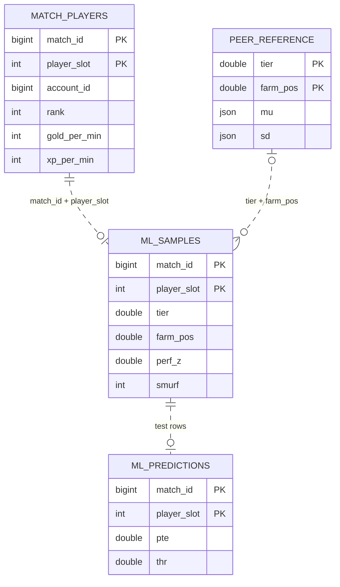
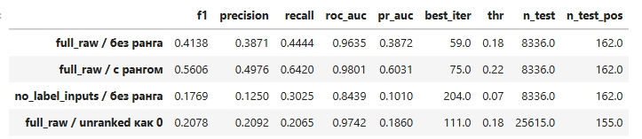
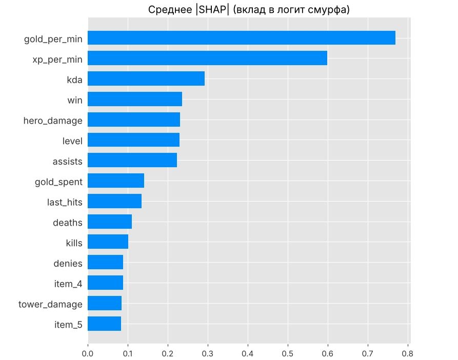
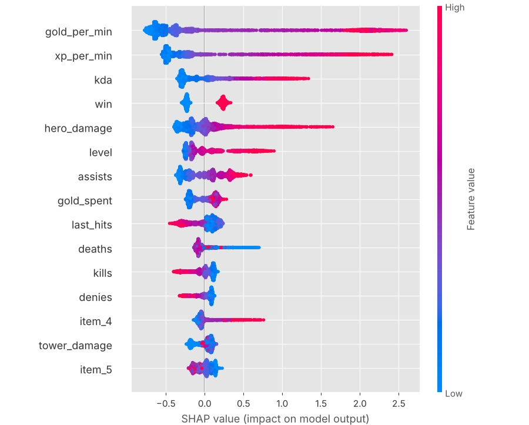
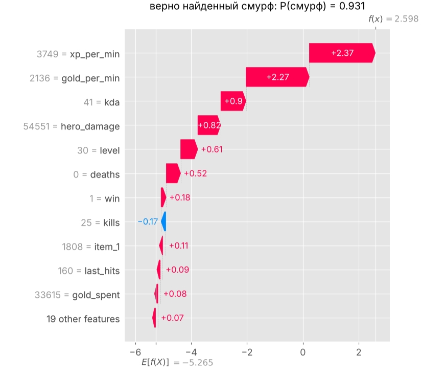

# Паспорт кейса 2: обнаружение смурфов

**Направление:** ML №18 · **Дата:** 14 ноября 2026 года.

## 1. Задача и данные

- **Цель:** определять игроков-смурфов по ключевым показателям их игры в матче.
- **Гипотеза:** сочетание GPM, XPM, KDA, урона героям и добиваний позволяет выявлять смурфов по результатам матча. Для оценки модели используются Average Precision, precision и recall.
- **Правило сравнения:** эталоны рассчитываются для групп одного ранга и позиции по фарму. Это принятое решение метода; польза такого группирования отдельным экспериментом не проверялась.
- **Одна строка данных** — выступление игрока в одном матче. Ключ: `(match_id, player_slot)`; `account_id` связывает выступления одного открытого аккаунта.
- **Данные в Data Lake:** `lakehouse.raw.pg__match_players`, исходный источник — PostgreSQL `dota.match_players`. Используются герой, предметы, убийства, смерти, ассисты, золото, опыт, урон, добивания, ранг и результат матча. Текущий исследовательский [ноутбук](smurf_pipeline_fixed_with_outputs_1__1.ipynb) читает исходную таблицу PostgreSQL напрямую; чтение из Data Lake в нём не реализовано.
- **Схемы:** [физическая модель источников](er_physical.md) и [логическая модель ML-процесса](er_logical.md). Ниже — сокращённое представление сущностей этих диаграмм.

`ML_SAMPLES`, `PEER_REFERENCE` и `ML_PREDICTIONS` обозначают вычисления и результаты в памяти ноутбука; создание таких таблиц в Data Lake не подтверждено.

## 2. Как подготовлены данные

1. При загрузке старого CSV удаляются прежние метки и производные поля, чтобы пересчитать их заново. Неиспользуемые `roles` и `name` исключаются.
2. Ранг `NULL` или `-1` считается неизвестным. В основном эксперименте такие строки исключаются.
3. Рассчитывается приблизительная длительность по золоту и GPM; сохраняются строки с длительностью от **15 до 90 минут**.
4. Рассчитываются показатели в минуту, ограниченный KDA и место игрока по GPM внутри команды. Пропуски в слотах предметов заменяются на `-99`.
5. Данные делятся на train, validation и test по аккаунтам. Для ID `0` и `4294967295` группа задаётся отдельно по матчу и слоту.
6. Средние и стандартные отклонения показателей рассчитываются **только на train** внутри групп `tier × farm_pos`, затем применяются к остальным частям. Строки с известным рангом без доступного эталона исключаются из оценки.

## 3. Какие новые поля рассчитаны

| Поле | Расчёт и смысл |
|---|---|
| `rank_known`, `calibration` | Известен ли ранг; обратный флаг неизвестного ранга |
| `anon` | Аккаунт имеет ID `0` или `4294967295`; служебный флаг группировки |
| `tier` | `floor(rank / 10)` — ранговая группа в текущем коде |
| `dur_min` | `(gold + gold_spent) / gold_per_min` — оценка длительности в минутах |
| `hd_pm`, `lh_pm` | Урон героям и добивания, разделённые на `dur_min` |
| `kda_c` | KDA с ограничением сверху: `min(kda, 15)` |
| `farm_pos` | Место по убыванию GPM внутри `(match_id, is_radiant)`; приближение к позиции по фарму |
| `perf_z` | Среднее доступных z-оценок GPM, XPM, `hd_pm`, `lh_pm`, `kda_c` относительно своей группы |
| `smurf` | Автоматическая метка: известен ранг, `tier <= 5` и `perf_z >= 1.5` |
| `label_ok` | Есть необходимые эталоны для расчёта разметки |
| `group` | Группа аккаунта для разделения данных без пересечения известных аккаунтов |

Z-оценка показывает отклонение от среднего своей группы в единицах стандартного отклонения. Чем выше `perf_z`, тем сильнее выступление относительно сопоставимых игроков.

## 4. Вручную найденные смурфы

- **По результатам ручной проверки команды найдены подтверждённые смурфы.** Их выступления сохранены в [smurf_players.csv](smurf_players.csv): **6 аккаунтов, 87 матчей и 87 строк**, все с меткой `smurf = 1`.
- Это отдельный набор ручных находок. В текущем ноутбуке он не подключён как обучающая или контрольная разметка; приведённые ниже метрики рассчитаны по автоматическим меткам из `perf_z`.
- Поэтому наличие ручного списка и измеренное качество модели — два отдельных результата. Для оценки качества на ручных находках требуется отдельная проверка модели на этом наборе и на проверенных обычных игроках.

## 5. Как работает модель и что получается на выходе

1. **CatBoostClassifier** обучается по послематчевой статистике, герою, предметам и исходу. ID, производные разметки и, в основном варианте, ранг исключаются из признаков.
2. Модель учится предсказывать автоматическую метку `smurf`. Параметры подбираются через **Optuna** с групповой кросс-валидацией.
3. На validation выбирается порог, дающий максимальный F1. Test используется для оценки результата.
4. **На выходе** для выступления игрока получается скор `pte` от 0 до 1. Сравнение с порогом `thr` даёт решение «кандидат на проверку / ниже порога». Это скор автоматической метки, его нельзя трактовать как проверенную вероятность реального смурфинга.
5. **SHAP** объясняет вклад признаков в прогноз. Сейчас скор и порог хранятся в памяти ноутбука; отдельная выгрузка прогнозов с ключами не реализована.

## 6. Насколько хорошо работает

**Сохранённая выборка:** train — **26 663**, validation — **6 674**, test — **8 336** строк. В test **162 положительные автоматические метки — 1,943%**.

| Метрика | Базовая модель | После Optuna |
|---|---:|---:|
| Average Precision | 0,3872 | 0,3880 |
| Precision | 38,71% | 38,76% |
| Recall | 44,44% | 30,86% |
| F1 | 0,4138 | 0,3436 |
| ROC-AUC | 0,9635 | 0,9653 |
| Порог | 0,18 | 0,65 |

- **Базовая модель:** среди отмеченных выступлений около 39% положительны по автоматической разметке; найдено около 44% всех положительных выступлений test.
- **Ранжирование:** Average Precision около 0,387 при доле положительных меток 0,0194 — существенно выше ориентира случайного ранжирования.
- **Optuna:** заметного улучшения на test нет; Average Precision почти не изменилась, F1 и полнота снизились. 95% bootstrap-интервалы AP: `[0,315; 0,471]` и `[0,313; 0,472]`.
- **Зависимость от разметки:** без сырых входов правила AP снижается до 0,1010. Значительная часть качества связана с воспроизведением правила разметки.

**Что влияет на прогноз:** наибольший вклад имеют GPM и XPM, затем KDA и другие показатели. Ниже сохранённые объяснения настроенной модели; глобальные SHAP-графики построены на всех положительных строках test и 4 000 случайных отрицательных.

**Пример отдельного прогноза:** высокие GPM, XPM и KDA повышают скор. Подпись «верно найденный смурф» на исходном изображении означает совпадение с автоматической меткой; ручная проверка именно этого примера не подтверждена.

## 7. Вывод и текущий статус

- Команда вручную нашла смурфов и сохранила их выступления в CSV. Модель отдельно показала способность выделять автоматически размеченные аномально сильные выступления.
- На сохранённом test Average Precision равна **0,3872**, precision — **38,71%**, recall — **44,44%**. Эти метрики показывают качество по автоматическим меткам. Для вывода о качестве определения настоящих смурфов нужно отдельно проверить прогнозы на ручной разметке; такая проверка гипотезы пока не завершена. Польза группирования по рангу и позиции отдельно не оценивалась.
- В текущем тексте ноутбука остаются `return df d` и неопределённая переменная `f` в `engineer()`: сохранённые результаты относятся к прежнему запуску, повторный запуск требует исправления. Границы `tier`, оценка длительности и состав peers также требуют сверки.
- Группы делятся по аккаунтам, но участники одного матча могут попасть в разные части; bootstrap выполнен по строкам, эталоны не пересчитываются внутри CV-фолдов. Эти ограничения нужно учитывать при оценке качества.
- Период входного среза не зафиксирован. Сохранённая модель, автоматическое обновление, SLA и публикация прогнозов в Data Lake/Superset пока не представлены.
