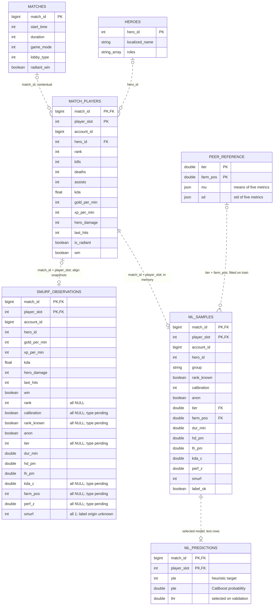

# Кейс 2 — логическая ER-модель ML-процесса

Эта схема объединяет исходные данные, вычисляемые сущности и результаты модели. `ML_SAMPLES`, `PEER_REFERENCE`, `ML_PREDICTIONS` выделены из кода как логические сущности; SQL-таблиц с такими именами в материалах нет.

## Основания и статус сущностей

| Сущность | Основание | Статус |
|---|---|---|
| `MATCH_PLAYERS` | `load_raw()` читает `SELECT * FROM dota.match_players` | Физическая таблица, основной вход ноутбука |
| `MATCHES`, `HEROES` | Описание источников проекта | Предметный контекст; текущий ноутбук их не читает |
| `SMURF_OBSERVATIONS` | `smurf_players.csv` | Фактический отдельный CSV кандидатов; не вход по умолчанию |
| `ML_SAMPLES` | Результат `engineer()`, затем `SmurfLabeler.transform()` | DataFrame в памяти |
| `PEER_REFERENCE` | `SmurfLabeler.mu_` и `sd_` по `tier × farm_pos` | Логическое объединение статистик, рассчитанных на train |
| `ML_PREDICTIONS` | Тестовые строки `test`, цели `yte`, вероятности `pte`, порог `thr` | Логическое объединение результатов одной выбранной модели |

## Ключи и связи

Участник определяется парой `(match_id, player_slot)`. `account_id` не является первичным ключом участника. В CSV эта пара уникальна на текущих 87 строках; соответствие с текущим снимком PostgreSQL не проверено. Поэтому связь CSV с участниками — предполагаемое сопоставление по ключу после сверки снимков, а не подтверждённый FK.

`ML_SAMPLES` наследует ключ участника, но ноутбук отдельно не проверяет его уникальность. Ключ `PEER_REFERENCE` — `(tier, farm_pos)` в пределах одного обученного разметчика. `mu` и `sd` компактно обозначают средние и стандартные отклонения пяти метрик: GPM, XPM, `hd_pm`, `lh_pm`, `kda_c`. В коде они хранятся в двух DataFrame, а не в JSON-столбцах.

Для `ML_PREDICTIONS` пара `(match_id, player_slot)` является ключом только в пределах одной конфигурации и тестовой выборки. В коде `pte` — массив, связанный с `test` по позиции. Версионирование моделей и отдельные таблицы прогнозов не реализованы.

`||` — ровно один, `|o`/`o|` — ноль или один, `o{` — ноль или много. Пунктир обозначает неидентифицирующую связь. `PK`/`FK` у вычисляемых сущностей — логические ключи, не ограничения СУБД. Для пустых столбцов CSV типы с пометкой `type pending` предположены по смыслу.

## Что рассчитывается

`dur_min = (gold + gold_spent) / gold_per_min` — оценка длительности, не фактическое время из `matches`. `farm_pos` — место по GPM в команде конкретного матча, не подтверждённая роль. `perf_z` — среднее доступных z-оценок относительно группы `tier × farm_pos`.

Метка `smurf` формируется эвристикой: известный ранг, `tier <= 5`, `perf_z >= 1.5`. CatBoost обучается воспроизводить эту метку; Optuna подбирает параметры, порог выбирается на validation, SHAP объясняет прогнозы. Такая метка не является независимым подтверждением смурфинга.

В текущем тексте `engineer()` есть `return df d` и обращение к неопределённому `f` при построении группы. Поэтому схема описывает структуру алгоритма, а сохранённые выводы ноутбука не подтверждают воспроизводимость текущего кода. Код при подготовке схем не изменялся и не запускался.

Источники: [ноутбук](smurf_pipeline_fixed_with_outputs_1__1.ipynb), [CSV](smurf_players.csv), [описание источников](../../requirements/Источники.%20Описание%20полей%20таблиц.md).

[Mermaid-исходник](er_logical.mmd) · [Фактическая модель](er_physical.md)
