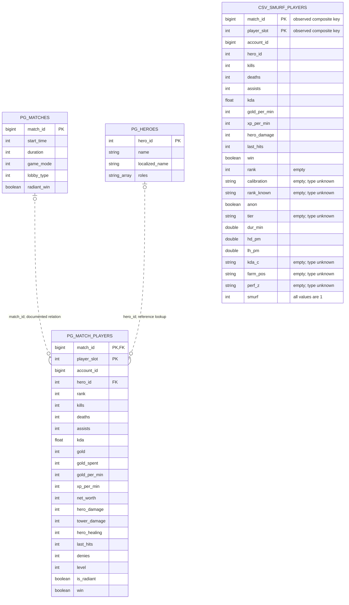

# Кейс 2 — ER-схема фактических таблиц и файла

В этой версии показаны только таблицы из описания источников проекта и существующий CSV. Промежуточные DataFrame, статистики разметчика и массивы прогнозов здесь не представлены как таблицы.

## Физические источники

| Обозначение | Реальный объект | Использование в текущем ноутбуке |
|---|---|---|
| `PG_MATCH_PLAYERS` | PostgreSQL `dota.match_players` | Основной вход: `SELECT * FROM dota.match_players` |
| `PG_MATCHES` | PostgreSQL `dota.matches` | Документированный контекст участника; запросов к таблице в ML-ноутбуке нет |
| `PG_HEROES` | PostgreSQL `dota.heroes` | Документированный справочник; запросов к таблице в ML-ноутбуке нет |
| `CSV_SMURF_PLAYERS` | Локальный `smurf_players.csv` | Отдельный файл кандидатов, не вход по умолчанию |

Поля PostgreSQL и их типы взяты из документации проекта. Схема показывает выбранные поля; инвентарь, часть статистик и служебные колонки опущены для читаемости. Это не результат чтения `information_schema`: подключение к PostgreSQL и проверка физических ограничений БД не выполнялись.

## Ключи и кратности

- `dota.matches`: документированный PK `match_id`.
- `dota.heroes`: документированный PK `hero_id`.
- `dota.match_players`: документированный составной PK `(match_id, player_slot)`; `account_id` в него не входит.
- `match_players.match_id → matches.match_id` — документированная связь; `hero_id → heroes.hero_id` — справочное сопоставление. Пометка `FK` обозначает назначение ссылки, наличие объявленного ограничения СУБД не проверено.
- `|o` на стороне матча/героя допускает отсутствие соответствия при анализе выгрузок. `o{` означает множество участников. Пунктир — неидентифицирующая связь.

CSV показан **без линии к PostgreSQL**: совпадение снимков и наличие соответствующих строк в текущей БД не проверены. Возможный ключ сверки — `(match_id, player_slot)`, но считать его подтверждённым внешним ключом файла нельзя.

В CSV 87 строк, 87 уникальных матчей и 6 аккаунтов. Пара `(match_id, player_slot)` уникальна и заполнена во всех строках. Её пометка `PK` означает наблюдаемый составной ключ этого файла; ограничений PK в CSV нет. Безымянный экспортный индекс не включён в модель.

`rank`, `calibration`, `rank_known`, `tier`, `kda_c`, `farm_pos`, `perf_z` полностью пусты. Типы пустых производных полей по содержимому CSV установить нельзя: на схеме `string` используется как обозначение нетипизированного CSV-поля с пометкой `type unknown`. Все значения `smurf` равны `1`; происхождение метки для этого файла не установлено.

## Граница текущей реализации

Если оставить только объекты, которые основной путь загрузки ML-ноутбука действительно читает, схема состоит из **одной таблицы `dota.match_players`**. Таблицы матчей и героев приведены для понимания структуры источника.

В альтернативном режиме ноутбук читает путь из `SMURF_CSV`; значение по умолчанию — `data_leak_df_problems.csv`, которого в материалах нет. Автоматической загрузки `smurf_players.csv` текущая конфигурация не задаёт. Таблиц ML-признаков, эталонов и прогнозов ноутбук не создаёт. `optuna_trials.csv` предусмотрен кодом как экспорт экспериментов, но фактического такого файла в `case2` при подготовке схем нет.

Источники: [ноутбук](smurf_pipeline_fixed_with_outputs_1__1.ipynb), [CSV](smurf_players.csv), [описание полей PostgreSQL](../../requirements/Источники.%20Описание%20полей%20таблиц.md).

[Mermaid-исходник](er_physical.mmd) · [Логическая модель](er_logical.md)
