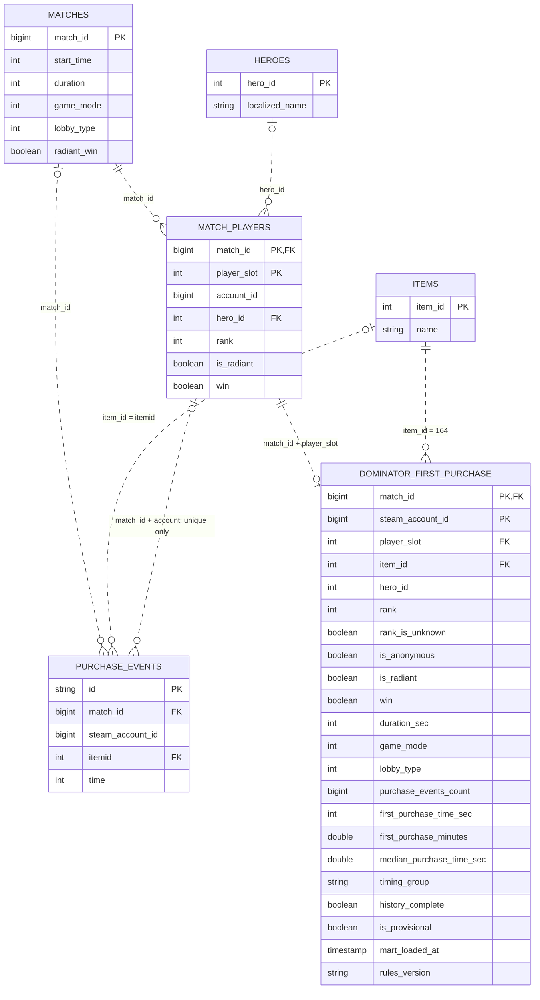
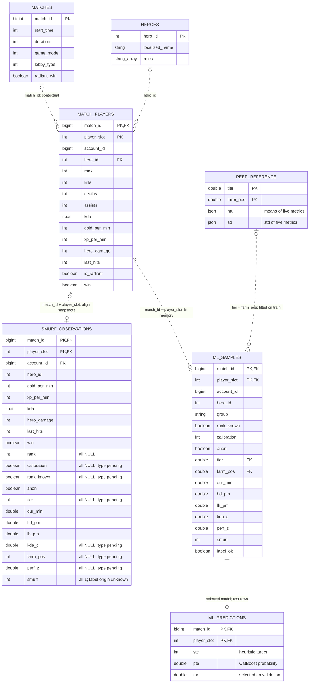
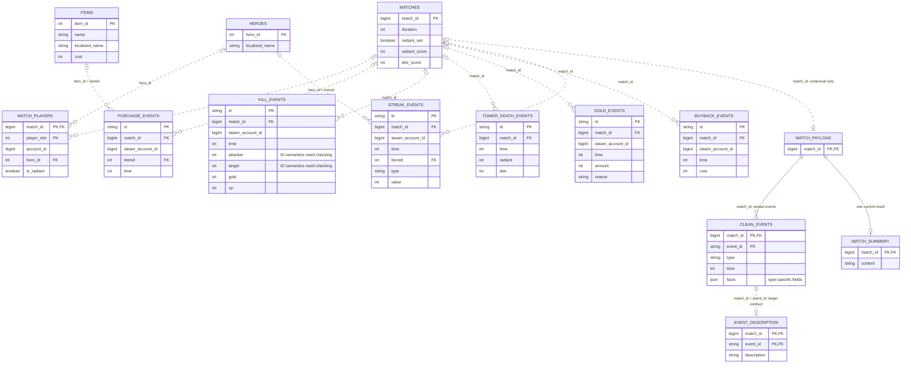

# Общая ER-модель и модели трёх кейсов

Дата: 14 ноября 2026 года. Основа — файлы `task/` и описание источников в `requirements/`. Подключения к кластеру, обучение моделей и вызовы LLM при подготовке схем не выполнялись.

## Как читать схемы

Это логическая ER-модель: она показывает сущности, ключи и кратности связей. Поток RAW → STAGE → MART и вызовы моделей описаны текстом: преобразование данных само по себе не является внешним ключом.

- `PK` — логический первичный ключ, несколько `PK` в сущности образуют составной ключ. Для RAW это ожидаемый ключ источника; фактическую уникальность каждой коллекции надо проверять.
- `FK` — логическая ссылка, а не подтверждение физического ограничения в Iceberg или CSV. Составной FK участника — `(match_id, player_slot)`.
- `||` — ровно один; `|o` / `o|` — ноль или один; `o{` — ноль или много; `|{` — один или много.
- Пунктир `..` — неидентифицирующая связь, сплошная `--` — идентифицирующая. Пунктир **не обозначает** статус готовности или надёжность связи.
- Ноль на стороне справочника/матча отражает возможность отсутствующего соответствия. Для соединения события с участником допускается не больше одного соответствия **после проверки однозначности**; неоднозначные RAW-строки в эту кратность не укладываются и требуют диагностики.
- Поля показаны выборочно. `json` и `string_array` — условные логические типы. Они не означают, что в источнике создан столбец именно такого типа.

`account_id` не является ключом участника матча. Связь покупки с участником: `purchase.match_id = mp.match_id AND purchase.steam_account_id = mp.account_id`, только при одном соответствии. Ключ самого участника — `(match_id, player_slot)`. Аккаунты `0` и `4294967295` нельзя считать идентификаторами уникальных людей.

## 1. Общая диаграмма

Общее ядро — `MATCHES`, `MATCH_PLAYERS`, `HEROES`, `ITEMS`. Покупки используются в кейсах 1 и 3; статистика участников — во всех трёх. Общая схема объединяет типы сущностей, но не утверждает совпадение периодов и снимков SQL, ML и LLM.

```mermaid
erDiagram
    MATCHES |o..o{ MATCH_PLAYERS : "match_id"
    HEROES |o..o{ MATCH_PLAYERS : "hero_id"
    MATCHES |o..o{ PURCHASE_EVENTS : "match_id"
    ITEMS |o..o{ PURCHASE_EVENTS : "item_id = itemid"
    MATCH_PLAYERS |o..o{ PURCHASE_EVENTS : "match_id + account; unique only"
    MATCHES |o..o{ KILL_EVENTS : "match_id"
    MATCHES |o..o{ TOWER_DEATH_EVENTS : "match_id"
    MATCHES |o..o{ GOLD_EVENTS : "match_id"
    MATCHES |o..o{ BUYBACK_EVENTS : "match_id"
    MATCHES |o..o{ STREAK_EVENTS : "match_id"
    MATCH_PLAYERS ||..o| DOMINATOR_FIRST_PURCHASE : "match_id + player_slot"
    MATCH_PLAYERS |o..o| SMURF_OBSERVATIONS : "match_id + player_slot; align snapshots"
    MATCH_PLAYERS ||..o| ML_SAMPLES : "match_id + player_slot; in memory"
    ML_SAMPLES ||..o| ML_PREDICTIONS : "one selected model; test rows"
    MATCHES |o..o| MATCH_PAYLOAD : "match_id; in memory"
    MATCH_PAYLOAD ||--o{ CLEAN_EVENTS : "match_id; nested events"
    MATCH_PAYLOAD ||--o| MATCH_SUMMARY : "one current result"

    MATCHES {
        bigint match_id PK
        int duration
        int game_mode
        int lobby_type
        boolean radiant_win
    }
    MATCH_PLAYERS {
        bigint match_id PK,FK
        int player_slot PK
        bigint account_id
        int hero_id FK
        int rank
        boolean is_radiant
        boolean win
        int gold_per_min
        int xp_per_min
    }
    HEROES {
        int hero_id PK
        string localized_name
    }
    ITEMS {
        int item_id PK
        string name
        string localized_name
        int cost
    }
    PURCHASE_EVENTS {
        string id PK
        bigint match_id FK
        bigint steam_account_id
        int itemid FK
        int time
    }
    KILL_EVENTS {
        string id PK
        bigint match_id FK
        bigint steam_account_id
        int time
        int attacker
        int target
    }
    TOWER_DEATH_EVENTS {
        string id PK
        bigint match_id FK
        int time
        int radiant
        int dire
    }
    GOLD_EVENTS {
        string id PK
        bigint match_id FK
        bigint steam_account_id
        int time
        int amount
        string reason
    }
    BUYBACK_EVENTS {
        string id PK
        bigint match_id FK
        bigint steam_account_id
        int time
        int cost
    }
    STREAK_EVENTS {
        string id PK
        bigint match_id FK
        bigint steam_account_id
        int time
        int heroId
        string type
        int value
    }
    DOMINATOR_FIRST_PURCHASE {
        bigint match_id PK,FK
        bigint steam_account_id PK
        int player_slot FK
        int first_purchase_time_sec
        double median_purchase_time_sec
        string timing_group
        boolean win
    }
    SMURF_OBSERVATIONS {
        bigint match_id PK,FK
        int player_slot PK,FK
        bigint account_id
        int hero_id
        double dur_min
        double hd_pm
        double lh_pm
        int smurf
    }
    ML_SAMPLES {
        bigint match_id PK,FK
        int player_slot PK,FK
        bigint account_id
        string group
        double tier
        double farm_pos
        double perf_z
        int smurf
        boolean label_ok
    }
    ML_PREDICTIONS {
        bigint match_id PK,FK
        int player_slot PK,FK
        double pte
        double thr
    }
    MATCH_PAYLOAD {
        bigint match_id PK,FK
    }
    CLEAN_EVENTS {
        bigint match_id PK,FK
        string event_id PK
        string type
        int time
        json facts
    }
    MATCH_SUMMARY {
        bigint match_id PK,FK
        string content
    }
```

### Соответствие физическим данным

| Сущности | Источник / представление | Кейсы |
|---|---|---|
| `MATCHES`, `MATCH_PLAYERS` | `lakehouse.raw.pg__matches`, `pg__match_players`; исходные PG-таблицы `dota.matches`, `dota.match_players` | 1, 2, 3 |
| `HEROES`, `ITEMS` | `lakehouse.raw.pg__heroes`, `pg__items` | 1, 2 (герои как контекст), 3 |
| `PURCHASE_EVENTS` | `lakehouse.raw.mongo__purchase_events` | 1, 3 |
| `KILL_EVENTS`, `TOWER_DEATH_EVENTS`, `GOLD_EVENTS`, `BUYBACK_EVENTS`, `STREAK_EVENTS` | `lakehouse.raw.mongo__kill_events`, `mongo__tower_death_events`, `mongo__gold_events`, `mongo__buyback_events`, `mongo__streak_events` | 3 |
| `DOMINATOR_FIRST_PURCHASE` | SQL для `lakehouse.mart.case1_dominator_first_purchase` подготовлен в `case1/mart/`; выполнение в кластере не подтверждено | 1 |
| `SMURF_OBSERVATIONS` | Файл `case2/smurf_players.csv`, отдельный срез кандидатов | 2 |
| `ML_SAMPLES`, `PEER_REFERENCE`, `ML_PREDICTIONS` | Логическое представление DataFrame, статистик `SmurfLabeler` и массивов результата ноутбука; SQL-таблицы не созданы | 2 |
| `MATCH_PAYLOAD`, `CLEAN_EVENTS`, `EVENT_DESCRIPTION`, `MATCH_SUMMARY` | Логические представления JSON, ответа модели и строки обзора в памяти ноутбука | 3 |

`PEER_REFERENCE` и `EVENT_DESCRIPTION` раскрыты на отдельных схемах для читаемости общей модели. `MATCHES` в кейсах 2 и 3 показан как предметный контекст: текущие ноутбуки эту таблицу не читают.

## 2. Кейс 1 — Доминатор и винрейт

Изучены [исходная модель](case1/data_model.md), [паспорт](case1/case_definition.md), файлы [STAGE](case1/stages/) и [MART](case1/mart/README.md). Исходная ER-диаграмма сохранена. Здесь та же предметная модель дополнена подготовленной детальной витриной.

В RAW имена поля предмета различаются: `ITEMS.item_id` и `PURCHASE_EVENTS.itemid`; STAGE покупок называет его `itemId`. На схеме событий оставлено RAW-имя. `MATCHES.start_time` есть в RAW, но текущая проекция STAGE его не передаёт. Герои — справочное обогащение; текущий MART-запрос не соединяется с `HEROES` или `ITEMS`, поскольку предмет `164` задан константой.

Одна строка детальной витрины — первая допустимая покупка Доминатора одним покупателем в одном матче, PK `(match_id, steam_account_id)`. Слот сохраняется после однозначного сопоставления с участником. Отсутствующие и неоднозначные связи не восстанавливаются по одному матчу.

Преобразование: `stage.matches + stage.match_players + stage.purchase_events → mart.case1_dominator_first_purchase → mart.case1_dominator_winrate`. Используется текущий SQL в `case1/mart/`, а не альтернативные разработки в `night/`.

Правила детальной витрины: предмет `164`, от одного до двух событий на покупателя, проверка всей доступной истории пары до `MIN(time)`, корректное время в пределах длительности, согласованный исход и фильтры режима/лобби. Порог — медиана первых времён на очищенном срезе; `early` не позже медианы, `late` позже. Полнота истории не подтверждена: `history_complete = NULL`, `is_provisional = true`.

`case1_dominator_winrate` — агрегат **из одной строки на весь текущий срез**, в том числе на пустом входе. Содержит `buyers_count`, `matches_count`, медиану, счётчики групп, `early_win_rate`, `late_win_rate`, `win_rate_diff_pp`, `target_diff_pp = 3.0`, `target_reached`, служебные поля. В текущем SQL у сводки нет PK/FK: рисовать связь «одна первая покупка → одна строка винрейта» как внешний ключ было бы неверно. Поэтому сводка описана здесь, отдельно от ER-связей.

## 3. Кейс 2 / ML №18 — обнаружение смурфов

Изучены [CSV](case2/smurf_players.csv) и [ML-ноутбук](case2/smurf_pipeline_fixed_with_outputs_1__1.ipynb). CSV кандидатов и вход обучения представлены отдельно: ноутбук по умолчанию читает **всю `dota.match_players`**, а не этот CSV. Альтернативный CSV-путь в конфигурации — `data_leak_df_problems.csv`; такой файл в материалах не найден.

### Единицы данных и ключи

| Сущность | Одна запись | Ключ / связь |
|---|---|---|
| `MATCH_PLAYERS` | Участник конкретного матча | `(match_id, player_slot)` |
| `SMURF_OBSERVATIONS` | Строка отдельного CSV кандидатов | `(match_id, player_slot)` уникален в текущем CSV; связь с текущим PG-снимком не проверена |
| `ML_SAMPLES` | Участник после `engineer` и разметки; до или после фильтров | Ожидаемый ключ `(match_id, player_slot)` унаследован от источника, ноутбук его уникальность не проверяет |
| `PEER_REFERENCE` | Средние и стандартные отклонения пяти метрик для одной группы peers | `(tier, farm_pos)` в пределах одного `SmurfLabeler.fit(train)` |
| `ML_PREDICTIONS` | Прогноз для участника тестовой выборки выбранной модели | Логически `(match_id, player_slot)` в пределах одной конфигурации; в коде `pte` — массив с позиционным соответствием `test` |

`PEER_REFERENCE.mu/sd` — компактная запись двух DataFrame `mu_` и `sd_`, содержащих `gold_per_min`, `xp_per_min`, `hd_pm`, `lh_pm`, `kda_c`. Это не существующие JSON-колонки БД. `ML_PREDICTIONS` объединяет `test`, `yte`, `pte`, `thr` как логический результат; отдельная таблица с такими столбцами не записывается.

`group` — группа разбиения: для открытого профиля строковый `account_id`, для анонимной строки — `anon_<match_id>_<player_slot>`. Это служебный признак, не идентификатор человека. Групповое разбиение по аккаунтам не гарантирует отсутствия одного матча в разных частях выборки.

### Что вычисляет код

- `rank_known` — ранг известен; `calibration` — обратный флаг как 0/1; `tier = floor(rank / 10)` — именно формула текущего кода, её соответствие документированным диапазонам рангов требует сверки.
- `dur_min = (gold + gold_spent) / gold_per_min`, затем фильтр 15–90 минут. Это **оценка длительности**, не `matches.duration / 60`.
- `hd_pm`, `lh_pm` — урон героям и добитые крипы на оценённую минуту; `kda_c = min(kda, 15)`.
- `farm_pos` — позиция по GPM внутри `(match_id, is_radiant)`. Это прокси фарма, не подтверждённая игровая роль. `heroes.roles` описывает возможности героя и также не устанавливает роль участника конкретного матча.
- `perf_z` — среднее доступных z-оценок пяти метрик относительно эталонов `tier × farm_pos`, обученных на train.
- `smurf = 1`, если известен ранг, `tier <= 5` и `perf_z >= 1.5`; `label_ok` отмечает наличие нужного эталона. Это эвристическая разметка, не независимое подтверждение смурфинга.
- Далее: CatBoost, подбор параметров Optuna, выбор порога по validation, прогнозы `pte` на test и SHAP. В коде нет Isolation Forest; модель оценивается относительно эвристической метки.

CSV содержит **87 строк, 87 матчей, 6 аккаунтов**, повторов `(match_id, player_slot)` нет. Все `smurf = 1`; полностью пусты `rank`, `calibration`, `rank_known`, `tier`, `kda_c`, `farm_pos`, `perf_z`. Типы полностью пустых производных полей на схеме предполагаются по их смыслу и помечены `type pending`. Первый безымянный столбец CSV — экспортный индекс, не ключ предметной модели. Прочие поля инвентаря/статистики есть в файле, но опущены на диаграмме.

**Ограничение воспроизводимости:** в ячейке `engineer` текущего ноутбука есть синтаксическая ошибка `return df d` и обращение к неопределённому `f` при построении `uniq`. В ноутбуке сохранены выводы 12 ячеек, но они не подтверждают исполнение текущего текста. Схема ML-сущностей описывает структуру алгоритма; обучение при этой работе не запускалось, код не изменялся.

## 4. Кейс 3 / LLM №24 — саммари матча

Основа — [ноутбук](case3/case3.ipynb). Он читает шесть коллекций событий, `pg__match_players` и `pg__heroes`; покупки дополнительно соединяет с `pg__items`. Таблицу `pg__matches` текущий код не читает, поэтому её поля не становятся фактами обзора автоматически.

### Источники фактов

| RAW-сущность | Фильтр / преобразование | Тип в `clean_events` |
|---|---|---|
| `KILL_EVENTS` | `id IS NOT NULL`; attacker, target, gold, xp | `hero_kill`, ID `kill:<id>` |
| `TOWER_DEATH_EVENTS` | `id IS NOT NULL`; маски `radiant`, `dire` | `tower_destroyed`, ID `tower_destroyed:<id>` |
| `GOLD_EVENTS` | `LOWER(reason) = 'roshan'`; `amount → gold` | `roshan_reward`, ID `roshan_reward:<id>` |
| `BUYBACK_EVENTS` | `id IS NOT NULL`; `cost` | `buyback`, ID `buyback:<id>` |
| `PURCHASE_EVENTS` | INNER JOIN с `ITEMS`; `cost > 2000`; имя и цена предмета | `item_purchase`, ID `purchase:<id>` |
| `STREAK_EVENTS` | `KILL_STREAK` / `MULTI_KILL`; `heroId`, `value` | `kill_streak` / `multi_kill`, ID `streak:<id>` |

Все выборки ограничены одним `match_id`. Покупки без справочника предмета и предметы с неизвестной ценой в текущий payload не попадают. Награда `Roshan` — факт начисления золота, который сам по себе не устанавливает отдельное уникальное убийство Рошана.

`MATCH_PAYLOAD` — объект `match_payload` с `match_id` и массивом `events`. `CLEAN_EVENTS` — элементы `clean_events`: `event_id`, `type`, `time` и дополнительные поля по типу события. На схеме `facts` обозначает эти поля компактно; буквального вложенного поля `facts` в JSON нет. `match_id` наследуется из внешнего объекта, не повторяется в каждом элементе массива.

Первый вызов LLM возвращает описания по `event_id` (`EVENT_DESCRIPTION`); второй — строку итогового обзора (`MATCH_SUMMARY`). На схеме ключи результата — логические: `match_id` задаётся контекстом вызова, `content` обозначает `summary_response.choices[0].message.content`. Таблиц хранения и истории запусков в ноутбуке нет. Кратности результата описывают один текущий запуск, а не ограничение на число возможных генераций матча.

### Связи и ограничения

Аккаунт события сопоставляется герою через участников того же матча. Ноутбук исключает `0` и `4294967295` из отображения аккаунтов и принимает только единственного героя с доступным именем. Поэтому линии от всех событий к `MATCH_PLAYERS` не нарисованы как безусловные FK. Для определения стороны по герою требуется единственная сторона в данном матче.

В описании источников `kill_events.attacker/target` названы Steam account ID, тогда как текущий ноутбук интерпретирует их как `hero_id`. Поэтому на схеме они **не отмечены FK к HEROES**. До проверки фактических данных эту семантику нельзя считать подтверждённой. `streak_events.heroId`, напротив, документирован как ID героя.

Связь `CLEAN_EVENTS → EVENT_DESCRIPTION` — целевой контракт по `(match_id, event_id)`. Текущий код проверяет наличие массива в ответе, но соединяет массивы через `zip`, без проверки длины, порядка и совпадения `event_id`. Значит, эта связь в коде пока не обеспечена: короткий ответ обрежет события, перестановка нарушит соответствие.

Текущий `summary_payload` передаёт на второй вызов только `event_id`, `type`, `time`, `description`. Структурированные поля команд, героев, предметов и чисел не копируются, хотя промпт просит на них опираться. Подтверждённые итог матча и первая кровь в текущей SQL-выборке не добавляются. Диаграмма не приписывает этим данным существование.

## Исходники диаграмм

[Общая](diagrams/common.mmd) · [Кейс 1](diagrams/case1.mmd) · [Кейс 2](diagrams/case2.mmd) · [Кейс 3](diagrams/case3.mmd). Первоначальная [модель кейса 1](case1/data_model.md) оставлена без изменений.
